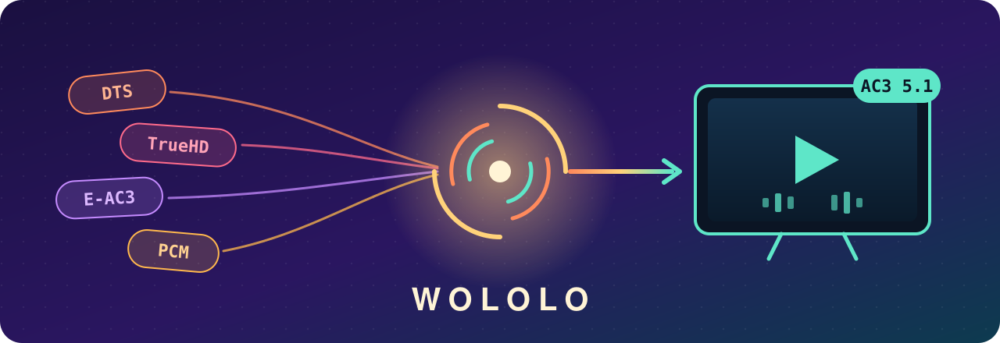

<p align="center"></p>

# Wololo

**Every TV in the house direct-plays your library.**

Wololo sits next to Radarr, Sonarr and Plex. When a file is imported, it converts the audio your TV can't decode (DTS, TrueHD, E-AC3, PCM) to AC3 5.1. Video, subtitles and chapters are copied untouched. It also turns decrypted Blu-ray folders and `.iso` images into a single MKV.

- **Hands-off:** Radarr/Sonarr webhook -> convert -> verify -> swap -> Plex rescan.
- **Safe:** starts in dry-run mode, verifies every file before replacing it and keeps originals in a recycle bin for 7 days.
- **Small:** one Docker image, amd64 and arm64, built for a Raspberry Pi 4.

## Quick start

```yaml
services:
  wololo:
    image: ghcr.io/stefanfriptu/wololo:main
    container_name: wololo
    environment:
      - PUID=1000
      - PGID=1000
      - TZ=Etc/UTC
    volumes:
      - ./wololo/config:/config
      - /srv/data:/data # same host folder and path as Radarr/Sonarr
    ports:
      - 8585:8585
    restart: unless-stopped
    stop_grace_period: 30s
```

1. Run `docker compose up -d wololo` and open `http://<host>:8585`.
2. Add your media folders under **Settings > Media**, and Radarr/Sonarr under **Settings > Connect**.
3. Run a scan and check **Library > Dry run**.
4. When the report looks right, tick **Convert files**.

## Docs

- [Guide](docs/GUIDE.md): setup, Plex, path mappings, safety model, backups, configuration, troubleshooting.
- [Architecture](docs/ARCHITECTURE.md) and [Spec](docs/SPEC.md) for contributors.

## License

[GPL-3.0](LICENSE)
